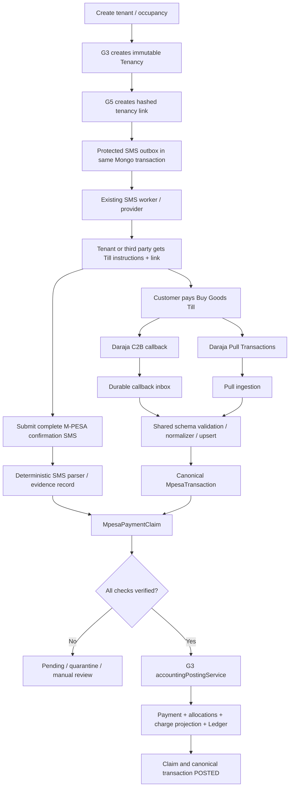

# G5 — M-PESA Buy Goods / Till Integration Architecture

**Document:** Feature architecture and repository integration audit  
**Feature:** G5  
**Repository:** `jolla3/tycoon-estates-backend`  
**Audited source snapshot:** `main` at `204c8f9c3578f753af20727799aaa049b1545135` (12 November 2026)  
**Document state:** Revised G5.0 design baseline  
**Implementation state:** G5 is not implemented. No G5 models, routes, jobs, migrations, credentials, or tests are claimed to exist.

> **Read with:** `PRD.md` for product requirements, `architecture-summary.md` for the short handoff, and `G5_IMPLEMENTATION_GUARDRAILS.md` for mandatory agent rules. G5.0 is documentation/source-audit work only. The pinned commit is an audit snapshot, not a claim that the live branch cannot have moved.

---

## 1. Purpose and system boundaries

G5 attributes an ordinary customer-to-merchant M-PESA Buy Goods / Till payment to the exact tenancy that the payer intended to settle. A Buy Goods payment does not provide the ordinary account-reference mechanism used by many PayBill flows. G5 therefore combines a tenancy-bound private submission link, the payer-submitted M-PESA confirmation SMS, and the merchant-side Daraja transaction record.

The system boundaries are strict:

| Domain | Owns | G5 relationship |
|---|---|---|
| G3 rent accounting | `Payment`, `PaymentAllocation`, `RentCharge`, `Ledger`, balances, charge allocation and accounting rules | Sole posting authority. G5 calls shared G3 posting; it does not write a second ledger. |
| G4 bank integration | Bank connections/credentials, bank transactions, bank ingestion and bank reconciliation | Remains separate. No M-PESA pseudo-bank records and no G4 date-rule changes. |
| G5 M-PESA | Merchant profile, tenancy submission link, SMS evidence, canonical M-PESA transaction, callback inbox, pull checkpoint, claim/review workflow | Verifies and attributes a receipt, then hands it to G3. |
| Existing SMS infrastructure | Delivery queue/provider boundary, including Celcom | Reuse it with a protected token-bearing payload. Do not build a competing SMS platform. |
| Safaricom Daraja | Merchant-side C2B callback and Pull Transactions, only where the merchant is actually enabled | Provider-specific details live in the Daraja adapter and must be evidenced. |

**Money stays in the Buy Goods Till.** G5 records a customer rent payment in Tycoon. It does not initiate a payment, transfer funds, withdraw funds, or reconcile merchant settlement into a bank account.

PayBill is explicitly outside scope. Do not alter or redesign its reference field/process.

## 2. Source baseline, audit method and confidence

### 2.1 Pinned source snapshot

The initial source audit inspected `jolla3/tycoon-estates-backend` at:

```text
main
204c8f9c3578f753af20727799aaa049b1545135
12 November 2026
```

The audit was a read-only repository inspection. No G5 tests, migrations, Daraja sandbox calls, or production transactions were run as part of that audit.

Before implementation, fetch the current `main` HEAD, compare it to the pinned commit, inspect the working tree, and re-read every source file being changed. If the branch has advanced, revalidate the findings instead of silently treating this snapshot as current.

### 2.2 Source areas inspected

| Area | Source paths at the pinned revision |
|---|---|
| Tenant and occupancy | `src/models/Tenant.js`, `src/models/Tenancy.js`, `src/services/tenant.service.js`, `src/services/tenancy.service.js` |
| House identity | `src/models/House.js` |
| G3 financial schema | `src/models/Payment.js`, `src/models/PaymentAllocation.js`, `src/models/RentCharge.js`, `src/models/Ledger.js` |
| G3 posting | `src/services/accountingPosting.service.js`, `src/services/ledger.service.js`, `src/services/rent.service.js`, `src/services/payment.service.js` |
| G4 ingestion/reconciliation | `src/models/BankTransaction.js`, `src/services/banking/transactionIngestion.service.js`, processing-claim/quarantine/sync services, `src/services/reconciliation.service.js` |
| SMS | `src/models/SmsMessage.js`, `src/services/sms.service.js`, `src/services/sms/sms.factory.js`, Celcom provider implementation |
| HTTP/jobs | `src/app.js`, `src/routes/index.js`, `src/routes/webhook.routes.js`, `src/jobs/scheduler.js`, `src/jobs/smsReminder.job.js` |
| Indexes/tests | `src/utils/ensureIndexes.js`, financial index-readiness helpers, `scripts/migrations/*`, `tests/helpers/db.js`, `tests/helpers/g3Indexes.js` |

### 2.3 Immutable source links

These links point to the audited revision, not necessarily the current branch head:

- [Tenancy model](https://github.com/jolla3/tycoon-estates-backend/blob/204c8f9c3578f753af20727799aaa049b1545135/src/models/Tenancy.js)
- [Tenant service](https://github.com/jolla3/tycoon-estates-backend/blob/204c8f9c3578f753af20727799aaa049b1545135/src/services/tenant.service.js)
- [Tenancy service](https://github.com/jolla3/tycoon-estates-backend/blob/204c8f9c3578f753af20727799aaa049b1545135/src/services/tenancy.service.js)
- [Payment model](https://github.com/jolla3/tycoon-estates-backend/blob/204c8f9c3578f753af20727799aaa049b1545135/src/models/Payment.js)
- [G3 accounting posting service](https://github.com/jolla3/tycoon-estates-backend/blob/204c8f9c3578f753af20727799aaa049b1545135/src/services/accountingPosting.service.js)
- [Ledger service](https://github.com/jolla3/tycoon-estates-backend/blob/204c8f9c3578f753af20727799aaa049b1545135/src/services/ledger.service.js)
- [SMS service](https://github.com/jolla3/tycoon-estates-backend/blob/204c8f9c3578f753af20727799aaa049b1545135/src/services/sms.service.js)
- [SMS message model](https://github.com/jolla3/tycoon-estates-backend/blob/204c8f9c3578f753af20727799aaa049b1545135/src/models/SmsMessage.js)
- [Application mounts](https://github.com/jolla3/tycoon-estates-backend/blob/204c8f9c3578f753af20727799aaa049b1545135/src/app.js)
- [G4 ingestion reference](https://github.com/jolla3/tycoon-estates-backend/blob/204c8f9c3578f753af20727799aaa049b1545135/src/services/banking/transactionIngestion.service.js)
- [Index readiness entry point](https://github.com/jolla3/tycoon-estates-backend/blob/204c8f9c3578f753af20727799aaa049b1545135/src/utils/ensureIndexes.js)

### 2.4 Findings that were confirmed in the audited source

- Stack: Node.js ESM, Express 4, Mongoose 8, MongoDB transactions, Redis for coordination, Jest.
- `Tenancy` is a historical occupancy record with `ACTIVE`, `CLOSED`, and `VOID` status, `startAt`, `endAt`, and `ledgerRev`.
- `tenancyContains()` uses the interval `startAt <= eventTime < endAt`. G4 bank reconciliation uses it to resolve occupancy at transaction time. G5 must not weaken or bypass it for G4.
- `Payment.origin` already allows `MPESA`.
- `Payment.mpesaReceiptId` is an ObjectId field and has a unique partial index for ObjectId values in the audited model. The live database index must still be inspected at implementation time. The shared posting service does not yet implement the MPESA idempotency/linkage branch.
- G3 shared posting already creates Payment, allocation rows, charge projection updates and Ledger movement within a MongoDB transaction, checks supplied charges against exact tenancy scope, and uses tenancy/allocation serialization controls.
- `ledgerService.postEntry()` requires a Mongo session and exact source Payment reference for tenancy-scoped RENT PAYMENT entries. The service does not itself require the Tenancy to be ACTIVE. This observation alone does not prove that every late-arrears or overpayment path is complete.
- `tenantService.create()` creates Tenant and Tenancy in one Mongo transaction.
- `tenancyService.moveToHouse()` uses a transaction for its tenancy lifecycle work.
- `tenantService.update(status='moved_out')` currently updates Tenant status and then closes the Tenancy separately. G5 must not attach link lifecycle to this non-atomic path without correcting or centralizing the transaction boundary.
- `SmsMessage.message` is plaintext in the audited implementation and is returned through tenant detail/SMS history paths. A bearer URL must not be placed in that field without a protected payload and redaction design.
- G4 bank models are provider/enum-bound to bank providers. They are not generic M-PESA merchant records.
- Existing code has useful patterns for guarded indexes, durable ingestion, claims/quarantine, Redis scheduler coordination, audit and transaction-safe processing. Those patterns may be adapted without reusing bank-domain entities.

### 2.5 Findings that are not proven

The following are deliberately **not** claimed:

- That every Buy Goods Till can use both Daraja C2B callbacks and Pull Transactions.
- That a public API mirror proves the actual merchant's enabled product, payload, callback security, request method, pagination, or query horizon.
- That all Till/Store/Head Office/Notification/Nominated numbers map one-to-one.
- That current G3 posting safely represents unapplied credit/overpayment for a closed tenancy.
- That zero cached balances prove complete historical ledger coverage.
- That Celcom `unknown` delivery can be queried or safely retried.
- That a generic app credential model is correct for every merchant.

These items are release gates. See `PRD.md` and `G5_IMPLEMENTATION_GUARDRAILS.md`.

## 3. Reuse, extend, and create boundaries

### 3.1 Reuse without redesign

| Existing component | G5 use | Constraint |
|---|---|---|
| `Tenancy` | Historical occupancy and ownership identity | Link stores exact `Tenancy._id`; never follow mutable current Tenant/House pointers. |
| `RentCharge` | Existing rent obligations | Only eligible rows attached to the exact link-bound tenancy can be considered. |
| `PaymentAllocation` | Allocation rows | No second allocation collection or parallel allocator. |
| `Payment` | Rent receipt accounting record | Extend with MPESA linkage using existing `origin` and `mpesaReceiptId` semantics. |
| `Ledger` / `ledgerService` | Accounting movement and rent account history | G5 never writes Ledger directly. |
| Mongo sessions/transactions | Atomic lifecycle, claim and financial writes | Required for the financial and lifecycle guarantees. |
| Redis locks/scheduler | Coordinate multi-instance scheduled work | Redis is not the idempotency barrier or financial truth. |
| SMS factory/provider/worker | Outbound tenant instructions | Keep the existing delivery boundary; add a secure payload path. |
| Audit service | Record authorized configuration/review actions | No bearer tokens, credentials, or unredacted SMS content in audit metadata. |
| G4 claim/quarantine/sync patterns | Reference for durable work and fenced ownership | Adapt patterns into M-PESA records. Do not reuse `BankTransaction`. |

### 3.2 Extend existing components

| Component | Required change | Verification before change |
|---|---|---|
| `tenantService.create()` | Create link + protected outbound notification item in the same transaction after exact Tenancy creation. | Trace all creation callers and transaction/session conventions. |
| `tenancyService.moveToHouse()` | Close old Tenancy and create a separate new link/outbox for new Tenancy in one transaction. | Trace all move callers and any side effects outside the transaction. |
| `tenantService.update(status='moved_out')` | Replace the current split status/close flow with a single transaction-safe lifecycle operation before coupling link state. | Trace callers, status transitions, tenancy close and rollback effects. |
| Other close/void/admin paths | Apply link transitions consistently without retargeting links. | Find every Tenancy status writer and direct model update. |
| `SmsMessage` / `sms.service.js` | Add protected outbound payload, session-aware enqueue, decryption-at-send, and history/API redaction. | Trace `queueSms`, `withIdempotency`, worker, history, tenant detail, serializer and logs. |
| `accountingPosting.service.js` | Add MPESA identity lookup, scope validation, retry validation and claim consumption within existing transaction. | Trace every caller and prove BANK/MANUAL unchanged. |
| `Payment.js` | Add `ref: 'MpesaTransaction'` to existing ObjectId `mpesaReceiptId` if confirmed compatible. | Inspect all reads/writes, index definition, serializers and migration state. |
| Index readiness/migrations | Add G5 identity-index preflight and runtime readiness. | Follow repository's migration ownership; do not create/drop financial unique indexes at ordinary startup. |
| `app.js` / webhook routes | Mount provider callback at public webhook boundary; add separate bearer-token submission route. | Verify exact middleware order, CSRF boundary, body size, request logging and error reporting. |
| `scheduler.js` | Register pull, callback inbox recovery and claim reconciliation jobs. | Verify lock naming, worker lifecycle, overlap, shutdown, metrics and retry conventions. |

### 3.3 New G5 records

Recommended initial domain boundaries:

| Record | Purpose |
|---|---|
| `MpesaMerchantProfile` | Merchant configuration, Safaricom identity dimensions, allowed client/estate/store scope, readiness/registration state and credential references. |
| `MpesaSubmissionLink` | Hash-only secret, exact immutable tenancy snapshot, lifecycle status, rotation/revocation metadata. |
| `MpesaSmsSubmission` | User-submitted evidence, encrypted raw message if retained, digest, parsed fields, parser version and status. |
| `MpesaTransaction` | One canonical normalized Daraja C2B transaction per verified merchant identity and external receipt. |
| `MpesaPaymentClaim` | Claim joining a link/SMS submission to one canonical transaction, comparison results, fenced state and G3 posting reference. |
| `MpesaCallbackEvent` | Durable callback inbox/quarantine, source digest, processing state and sanitized/encrypted evidence as required. |

Do not automatically create one service/file per table. Keep responsibilities cohesive and follow existing project layout. The Daraja adapter should live under the M-PESA service boundary, for example:

```text
src/services/mpesa/
  providers/daraja/
    daraja.client.js
    daraja.adapter.js
    daraja.schemas.js
    daraja.auth.js       # only if the verified product contract requires it
```

The concrete file layout is a proposal. The agent must inspect current service conventions before choosing names or splitting files.

## 4. Domain invariants

1. `Tenancy._id` is the historical occupancy identity. Current `Tenant.houseId`, `Tenant.status`, and `House.tenantId` are mutable pointers only.
2. A submission link is never reassigned to another Tenancy. Its secret can be rotated/revoked; its historical association cannot change.
3. A link is a bearer tenancy-association credential, not proof of the submitter's identity.
4. A third-party payer is allowed; payer MSISDN equality with the tenant's registered phone is not required.
5. SMS content is untrusted evidence and is not merchant-side proof of receipt.
6. A Daraja callback/pull record proves a merchant-side transaction only to the extent of its verified provider contract. It does not, by itself, identify the intended tenancy.
7. Callback and pull data for the same transaction converge to one canonical record.
8. One canonical M-PESA receipt can produce at most one successful G3 Payment.
9. All posting remains inside G3. G5 does not write Payment, PaymentAllocation or Ledger directly from a route, callback controller or worker.
10. All allocations belong to the exact tenancy and eligible charge set selected by the link-bound claim.
11. A closed tenancy can receive a late payment only against pre-existing obligations of that same tenancy. No new charge generation and no cross-tenancy credit transfer.
12. Unapplied amount must remain old-tenancy credit or be held for review if current G3 semantics cannot safely represent it.
13. MongoDB unique constraints and transaction checks provide final financial idempotency. Redis is only coordination.
14. PayBill and G4 bank reconciliation remain unchanged.

## 5. End-to-end data flow



The SMS can arrive before Daraja. Daraja can arrive before the SMS. Both orderings must converge without double posting or changing tenancy association.

## 6. Merchant configuration and Safaricom identity

### 6.1 Keep provider identity dimensions separate

The Safaricom Buy Goods guide distinguishes Till Number, Store Number, Notification Number, Nominated Number and Head Office context. For aggregated arrangements, transaction/statement visibility may be at Store level. Buy Goods customers are not required to supply a unique account number. This is why the tenancy link is necessary for attribution and why G5 must not flatten the merchant identity hierarchy.

Do not assume these values are interchangeable:

- customer-facing Till number;
- Daraja shortcode/merchant identifier used by a specific API;
- Store Number;
- Head Office number;
- Notification Number;
- Nominated Number/MSISDN;
- any settlement or bank-account identifier.

The exact semantics must be taken from the client's account and the relevant authenticated Daraja operation, not inferred from field names.

### 6.2 Merchant-profile ownership model

The actual client's mapping may be:

- one Till/Store mapped to one estate;
- one merchant hierarchy shared across multiple estates/stores; or
- multiple tills/stores under a single client account.

Do not hardcode one of these before verifying the client's actual account structure. The profile must represent an explicit allowlisted mapping between verified provider identity and Tycoon client/estate/store scope. If a transaction cannot be resolved to one permitted scope, disable automatic posting and send it to review.

### 6.3 Candidate merchant fields

A candidate `MpesaMerchantProfile` may contain:

```text
_id
clientId
provider = SAFARICOM
merchantType = BUY_GOODS_TILL
customerTillNumber
apiShortCode                 // only if this exact API contract uses it
storeNumber
headOfficeNumber
notificationNumber
nominatedNumber
allowedEstateIds / store mappings   // exact structure depends on verified hierarchy
currency = KES
profileStatus
c2bRegistrationStatus
pullRegistrationStatus
credentialReference(s)
credentialVersion(s)
lastCallbackAt
lastSuccessfulPullAt
createdByUserId / updatedByUserId
```

These are candidate fields, not a final schema. Keep provider-only fields in the provider adapter/configuration boundary where appropriate. Do not add fields that the actual Daraja contract or verified merchant configuration does not use.

### 6.4 Credential separation and ownership

Distinguish:

- Daraja application Consumer Key / Consumer Secret;
- merchant shortcode/Till/Store/Head Office identifiers;
- notification/nominated phone numbers;
- API-specific initiator credentials, only if a verified API requires them.

G4 `BankConnection` / `BankCredential` are bank-specific and must not be reused as generic Daraja credential containers. Reuse approved encryption/key-versioning patterns only after inspecting the live code and deciding whether credentials are app-level (Tycoon-owned) or merchant-specific. Do not choose shared versus per-merchant credentials before verifying authenticated portal onboarding.

Do not assume an API initiator is required for inbound C2B callback/Pull merely because an initiator identity exists for a separate outbound B2B product.

## 7. Tenancy submission-link lifecycle

### 7.1 Creation and transaction boundary

`tenantService.create()` already creates Tenant and Tenancy inside a MongoDB transaction in the audited source. Extend the transaction, after the exact ACTIVE Tenancy exists, to:

1. create a cryptographically random token of at least 32 bytes;
2. compute its one-way hash or keyed digest;
3. create `MpesaSubmissionLink` with exact tenancy and owner snapshot;
4. create the protected outbound SMS item using the same Mongo session;
5. commit the transaction;
6. allow the existing SMS worker to decrypt and send only after commit.

No external provider call may occur while the MongoDB transaction is open.

The actual implementation must trace all tenant/tenancy creation paths, not just one service entry point. If a tenancy is created through a second route or admin workflow, it must follow the same link creation policy or be explicitly excluded by owner decision.

### 7.2 Token design and browser handling

- Generate at least 256 bits using the platform CSPRNG.
- Store only a SHA-256 hash or keyed HMAC digest, with unique index. Choose keyed versus unkeyed lookup only after reviewing the current key-management conventions.
- Compare token digests safely. Do not reveal whether the token hash exists.
- Prefer placing the token in a URL fragment, which is not sent in the initial HTTP request, then immediately remove the fragment from browser history and submit it in a POST body. The token must not appear in query/path logs, analytics, referrers or traces.
- Do not place the permanent bearer token in localStorage or sessionStorage. Keep it in memory for the form session only.
- The landing page must have no third-party analytics/pixels, must set `Cache-Control: no-store` and `Referrer-Policy: no-referrer`, and must use restrictive CSP and rate limiting.
- Avoid revealing tenancy, tenant or financial details until token validation succeeds.

If a different token transport is proposed, the agent must prove that browser history, proxies, access logs, request traces, analytics, referrer headers and error reporting cannot disclose it.

### 7.3 Association permanence vs secret rotation

The tenancy association is permanent for the life of the record. The bearer secret must be revocable and replaceable after a compromised handset, forwarded link, staff departure or suspected exposure. Rotation creates a new secret hash/version for the same `tenancyId`; it must not create a new tenancy or re-point history. Any in-flight submission must be checked against explicit rotation/revocation semantics.

### 7.4 Link states

Candidate states:

- `ACTIVE`: tenancy is active; evidence may be submitted.
- `ARREARS_ONLY`: tenancy is closed; submissions may only seek settlement of existing eligible obligations of that exact Tenancy.
- `SETTLED`: verified historical coverage, all eligible obligations resolved, no unapplied credit and no open/pending/conflicting claims.
- `REVOKED`: secret/link invalidated by an authorized action or security event.

Do not apply an arbitrary short calendar TTL to a permanent tenancy association. Business lifecycle controls the association; security rotation controls the secret.

### 7.5 Move, close and void

- A move closes the old Tenancy and creates a separate new Tenancy. Create a new link for the new Tenancy in the same transaction.
- Preserve the old link's original `tenancyId` and owner snapshot.
- On close, set old link to `ARREARS_ONLY` if debt, unresolved claims, unapplied credit, or unverified historical coverage may remain.
- Set `SETTLED` only when the PRD settlement conditions are proven. A zero cached charge projection is not sufficient.
- A `VOID` Tenancy cannot receive automatic posting; revoke or hold its link for authorized review according to the correction/audit process.
- The audited `tenantService.update(status='moved_out')` path currently performs Tenant update and Tenancy close separately. It must be replaced/centralized as an atomic lifecycle operation before G5 relies on it.
- Trace every status/close/void path and scheduled task. Do not wire link state into only `tenantService.create()` and `moveToHouse()` while leaving alternate lifecycle paths inconsistent.

## 8. Protected SMS delivery

### 8.1 Existing risk

In the audited source, `SmsMessage.message` is plaintext and appears in tenant detail and SMS history. The queue worker sends the message body to the provider. A permanent bearer URL placed in that field would be exposed through existing reads and logs.

### 8.2 Required design

Extend the current SMS pipeline rather than creating a second delivery system:

- Add a protected message discriminator or dedicated protected payload envelope for G5 onboarding.
- Keep ordinary API-visible message text as a non-secret placeholder/redacted display string.
- Encrypt the actual outbound SMS body using authenticated encryption (AES-256-GCM or the current approved equivalent), with a key identifier/version and associated data bound to message ID, client ID and message type.
- Store key material outside ordinary Mongo documents. Reuse current encryption/key custody practices only after inspecting them; do not invent an unmanaged hardcoded key.
- Make queue creation session-aware so the protected outbox item is committed atomically with the Tenant/Tenancy/link.
- Decrypt only immediately before provider send, in memory. Never log plaintext, ciphertext envelopes, keys or bearer tokens.
- Redact protected fields in `toJSON`, tenant detail, SMS history, admin listing, audit and error paths.
- Preserve all existing non-G5 SMS behaviour.
- Clear encrypted payload after confirmed delivery if recovery/retention policy permits. Retain only as long as required for controlled delivery recovery.
- Treat `unknown` as ambiguous delivery. Do not resend blindly. First verify whether Celcom exposes a delivery lookup or define a controlled operator confirmation process. This remains a blocker until proven.

A separate `MpesaNotificationOutbox` is acceptable only if the review demonstrates the current `SmsMessage` path cannot be safely extended. It must still feed the existing provider worker; do not create a second provider abstraction or queue.

## 9. Submitted SMS evidence and deterministic parser

### 9.1 Candidate record contents

A candidate `MpesaSmsSubmission` may contain:

```text
clientId, merchantProfileId, linkId, tenancyId
submittedAt, submittedByContext
rawMessageEnvelope       // encrypted, only if retention is approved
rawMessageDigest
parserVersion
receiptNumber
amountCents
transactionAt
merchant/Till identity fields when present
payerPhone / payerName when present
parseStatus
verificationStatus
```

Do not store more payer personal information than required. Decide raw message retention, dispute hold and authorized visibility before production. A digest and normalized fields support reconciliation but do not replace the original evidence where dispute policy requires it.

### 9.2 Parser contract

- Use deterministic parsers for known Safaricom confirmation templates. No LLM parsing.
- Version the parser so old submissions can be re-evaluated without changing their source evidence.
- Normalize receipt identifier, amount to integer cents, currency, transaction date/time and phone format.
- Parse only known, unambiguous date/time formats. Preserve the original text interpretation and parser version for audit.
- Reject or quarantine truncated, malformed, unsupported, ambiguous or contradictory messages.
- Enforce input length, control-character handling, safe HTML rendering and log-injection protection.
- Never log raw message text or include it in ordinary API responses.
- Do not use payer name similarity as an identity proof.

### 9.3 Third-party payer

Payer name/phone are descriptive evidence only. A third-party payer may submit the SMS through the tenant's link. The link establishes the intended Tenancy. If future product requirements need proof of the submitter's human identity, add a separate OTP/login feature through explicit approval. Do not reinterpret the bearer link as human authentication.

## 10. Daraja C2B callback and Pull Transactions

### 10.1 Shared ingestion path

```text
C2B callback ─┐
              ├─> provider schema validation -> normalization -> canonical upsert
Pull result ──┘
```

Both sources identify the same provider transaction. They must not create separate receipt/payment identities. Store provenance (first seen, last seen, source channels, provider correlation) separately from the canonical identity.

### 10.2 Callback ingress

- Add callback routes under the existing public webhook boundary, before cookie/CSRF-protected routes.
- Use a dedicated body-size limit, schema validation, rate/abuse controls and redacted request logging.
- Resolve merchant profile from verified provider identity fields. Never trust a callback-supplied `clientId` or `estateId` without a server-side mapping.
- Persist the callback event durably before returning success according to the verified provider acknowledgement contract.
- Persist malformed/unknown-merchant events in durable quarantine. If durable storage fails, return a retryable response only as permitted by the confirmed provider contract.
- Do not invent an HMAC/signature scheme, Basic auth, IP range or mTLS requirement. Confirm how the actual callback is authenticated or constrained. HTTPS and a hard-to-guess URL are not proof of transaction authenticity.
- A callback is not sufficient for tenant attribution or G3 posting. It must converge with the link-bound SMS and canonical merchant profile.

### 10.3 Pull recovery

- Register the merchant as required by the actual enabled product.
- Pull bounded overlapping windows at a frequency selected from actual provider limits and the operational recovery objective.
- Implement pagination exactly as confirmed by the provider contract. Do not assume offset/page/pageSize semantics.
- Send each item through the same validator, normalizer and canonical upsert as callbacks.
- Persist page/window checkpoints. Advance only after every response item is durably ingested or quarantined.
- Overlap windows to tolerate delayed visibility; canonical unique identity makes duplicate overlap safe.
- Alert when the last successful pull approaches the confirmed provider retention horizon. Do not conceal an expired recovery window by advancing the cursor.
- A publicly mirrored Daraja page describes Pull Transactions as C2B and mentions a 48-hour query horizon. Treat that as discovery evidence, not current merchant entitlement. Confirm the exact window in the authenticated portal and controlled sandbox.
- Transaction Status API may be considered later for a known receipt lookup; it is not a substitute for bulk Pull Transactions and is not required for initial G5 unless evidence shows a necessary gap.

### 10.4 Provider contract must be frozen from evidence

Before implementing the Daraja adapter, capture and review:

- exact endpoint, API version and sandbox/live base URL;
- HTTP method, path, authentication and required headers;
- exact registration/query request fields and casing;
- exact successful and failed response schemas;
- callback payload and acknowledgment code/body rules;
- callback authentication, source IP or other official security mechanism if any;
- Till, Store, Head Office, shortcode, Notification Number and Nominated Number semantics;
- merchant/app registration scope and re-registration behaviour;
- data visibility window, pagination/offset behaviour and ordering guarantees;
- transaction direction/type/reversal fields and their semantics;
- timestamp timezone, precision and formatting;
- any sandbox/live enablement or merchant approval requirements.

Use sanitized request/response fixtures from the actual sandbox. Keep secrets, MSISDNs and real payer data redacted. Do not bake unverified provider fields into the shared domain schema; isolate exact provider shapes inside `providers/daraja`.

## 11. Canonical transaction model and processing states

### 11.1 Candidate `MpesaTransaction` contents

```text
clientId
merchantProfileId
provider = SAFARICOM
receiptNumber                // external alphanumeric receipt
amountCents
currency = KES
transactionAt
merchantIdentitySnapshot     // allowlisted normalized Till/Store/shortcode values
payerPhone / payerName       // optional protected PII, if needed
sourceChannels[]             // callback, pull and source timestamps
providerCorrelationIds[]
sourcePayloadDigest(s)
sourcePayloadEnvelope?        // encrypted only if required by approved retention policy
ingestionState
verificationState
claimState
postingState
processingClaimToken
processingClaimExpiresAt
processingAttempts
lastProcessingErrorCode
matchedTenancyId?
paymentId?
```

Do not copy bank-specific fields wholesale. Do not use `BankTransaction` as a parent or shared identity.

### 11.2 State axes

Keep separate state axes; avoid one overloaded status:

- **Ingestion:** `RECEIVED`, `NORMALIZED`, `QUARANTINED`, `FAILED_RETRYABLE`.
- **Verification:** `UNVERIFIED`, `PENDING_EVIDENCE`, `MATCHED`, `CONFLICT`, `MANUAL_REVIEW`.
- **Claim:** `UNCLAIMED`, `CLAIMED`, `REVIEW`, `REJECTED`, `POSTED`.
- **Posting:** `NOT_POSTED`, `PROCESSING`, `POSTED`, `FAILED_RETRYABLE`, `FAILED_TERMINAL`.

Exact enums and permitted transitions are implementation design work. Enforce transitions with conditional updates and tests. An HTTP 200 callback, a successful SMS submission or a parsed message is not a posted payment.

## 12. Claim relationship and matching algorithm

### 12.1 Intended relationship

For the initial automatic flow:

- One `MpesaSmsSubmission` is created for each accepted submission attempt (retries deduplicate to the same logical submission where possible).
- One successful `MpesaPaymentClaim` exists per canonical `MpesaTransaction`.
- A claim references exactly one submission/link/tenancy and one canonical transaction.
- One canonical transaction may be submitted against multiple links due to error or malicious behaviour, but only one association can win; all conflicts are reviewed and none may silently replace a prior claim.
- A single submission must not fan out to multiple unrelated receipts. If a pasted message genuinely contains multiple receipt IDs, parser must reject it or treat it as multiple explicit submissions only after product approval.

The exact unique keys/idempotency strategy must be defined against actual schema and parser behaviour before implementation.

### 12.2 Candidate matching sequence

1. Validate token and resolve one `MpesaSubmissionLink` in `ACTIVE` or `ARREARS_ONLY` state.
2. Load the immutable link snapshot and verify it still matches the exact Tenancy ownership record; do not consult current tenant/house pointers for historical attribution.
3. Parse the full submitted SMS with a versioned deterministic parser.
4. Require an unambiguous receipt number and amount/time/merchant fields that the supported SMS template supplies.
5. Find canonical transaction using the verified merchant profile and external receipt number.
6. If no canonical transaction exists, persist pending evidence/claim and wait for callback/pull; do not post.
7. Compare all required fields and validate C2B credit direction.
8. Check that no other claim/payment has successfully consumed the receipt.
9. Acquire a conditional fenced claim lease in MongoDB.
10. Hand exact canonical transaction, immutable tenancy identity and eligible charges to shared G3 posting.
11. Consume the claim and set canonical posting state in the same MongoDB transaction as G3 financial writes.

### 12.3 Verification rules

Automatic match requires:

- exact external receipt number;
- exact amount in integer cents;
- verified merchant profile and allowed client/estate/store scope;
- transaction direction/type is customer-to-merchant C2B credit under the verified schema;
- transaction timestamp within the owner-approved/provider-evidenced tolerance;
- exact immutable Tenancy snapshot (`clientId`, `estateId`, `houseId`, `tenantId`, `tenancyId`);
- no prior successfully consumed claim/payment.

Payer phone equality is not required. Name similarity is not proof. A field that is required but absent, unrecognized or contradictory must stop automatic posting.

### 12.4 Duplicate and conflict handling

- Unique canonical identity should be `(merchantProfileId, receiptNumber)` only after provider semantics prove that is the correct scope.
- One successful claim per canonical `MpesaTransaction` must be enforced by a Mongo unique constraint or equivalent transactional unique key.
- If a second link submits a receipt already claimed or posted, preserve the first committed association, create an auditable conflict, and require authorized review. Never overwrite tenancy association.
- A unique live `Payment.mpesaReceiptId` constraint is the final G3 duplicate barrier. Inspect its actual database definition before relying on it.
- A retry that finds an existing Payment must verify exact origin, transaction reference, client, estate, house, tenant, tenancy, amount, payment date and allocation integrity before returning it as reused.

## 13. G3 accounting integration

### 13.1 Existing audited behaviour

At the pinned source revision:

- `Payment.origin` permits `BANK`, `MANUAL`, and `MPESA`.
- `Payment.mpesaReceiptId` is an ObjectId field. The audited model declares a unique partial index for ObjectId values.
- `accountingPosting.service.js` has canonical idempotency branches for BANK (`bankTransactionId`) and MANUAL (`paymentReference`) only. There is no MPESA idempotency branch and the create path does not yet populate `mpesaReceiptId`.
- `postConfirmedPayment()` enforces a tenancy, integer-cent amount, Mongo transaction support, financial index readiness and exact client/estate/house/tenant/tenancy ownership. Supplied charge scope is validated; Payment, allocations, charge projections and Ledger write in one transaction.
- G3 uses `Tenancy.ledgerRev`, allocation revision controls and ledger reference uniqueness to serialize/deduplicate financial operations.
- `ledgerService.postEntry()` requires a Mongo session and exact Payment source reference for tenancy rent PAYMENT entries.

These are source-audit observations, not a substitute for re-reading the current branch or running the new integration tests.

### 13.2 Required MPESA extension

Conceptual input to the shared posting path:

```text
origin: 'MPESA'
mpesaReceiptId: <canonical MpesaTransaction ObjectId>
paymentDate: <verified actual M-PESA transaction instant>
paymentReference: <external receipt string, for display only where G3 supports it>
tenancy: <exact Tenancy resolved from the claim/link>
charges: <exact existing eligible RentCharges for that tenancy>
```

Required service behaviour:

1. Reject `origin: 'MPESA'` without a valid canonical `mpesaReceiptId`.
2. Resolve and validate the canonical `MpesaTransaction` within the same client/merchant ownership scope.
3. Enforce idempotency by canonical internal transaction identity.
4. On retry, validate the existing Payment's full scope, amount, actual payment time, external receipt display value, and allocation/ledger integrity before returning it.
5. Persist `mpesaReceiptId` on Payment with the correct Mongoose ref after confirming compatibility.
6. Continue using G3's existing Payment/Allocation/RentCharge/Ledger transaction and revision locks.
7. The G5 claim-consumption update and canonical transaction POSTED state must execute inside the exact same MongoDB transaction as the G3 Payment/allocation/Ledger writes. The integration must use a caller-owned session or an equivalent reviewed transaction-orchestration hook; do not create nested/separate transactions and do not mark the claim POSTED afterwards in a second write.
8. Consume the processing lease conditionally with the current fencing token inside that transaction. A stale worker must fail the conditional write and must not commit after lease takeover.
9. Verify runtime readiness of the live unique Payment reference index. Do not assume schema declaration equals database reality.
10. Keep BANK and MANUAL branches unchanged and prove this with existing regression tests.

Do not call the staff `paymentService.recordManual()` path. Do not write Ledger directly from G5 routes/providers/workers.

### 13.3 Payment and Ledger semantics

A successful M-PESA receipt is one rent receipt accounting event:

- one G3 `Payment` with `origin: 'MPESA'`;
- one full amount Ledger PAYMENT movement referencing that Payment;
- zero or more `PaymentAllocation` rows to the exact eligible `RentCharge` records;
- existing G3 charge paid/balance/status projections updated from allocation rows.

The exact semantics of unapplied remainder/overpayment must be proven against current G3 code. Do not assume `Payment.allocatedCents`, cached balance or any one projection is authoritative. Allocation rows are authoritative per the existing G3 contract. If G3 does not safely preserve/represent a remainder after all eligible old charges are covered, automatic posting of the overpayment must remain disabled until a reviewed G3-compatible accounting design exists.

A later merchant bank deposit/withdrawal is not another tenant Payment.

## 14. Closed-tenancy arrears architecture

### 14.1 Why normal date matching is wrong here

The G4 tenancy resolver uses `startAt <= eventTime < endAt` to determine which tenancy occupied a house at a transaction time. That is appropriate for bank credits where the transaction itself has to be assigned to the occupancy active at that time.

A tenant can pay an old debt after move-out. The M-PESA transaction timestamp is after the old Tenancy's `endAt`, but the tenancy-specific submission link still identifies the debt the payer intended to settle. Resolving by the current occupant or transaction date would be wrong.

G5 must not change the shared G4 `tenancyContains()` rule. It must use an explicit link-bound arrears path.

### 14.2 Required arrears path

1. Resolve the link's exact `tenancyId` and immutable client/estate/house/tenant snapshot.
2. Lock that exact Tenancy through the existing G3 tenancy revision/serialization mechanism.
3. Permit `CLOSED` only through this explicit G5 arrears path. Reject `VOID` for automatic posting.
4. Select only already-existing outstanding RentCharges whose `tenancyId`, `clientId`, `estateId`, and `houseId` match the link snapshot.
5. Verify the charge periods/ownership against G3's billing rules. Do not invent prorated liabilities or generate missing charges for the closed tenancy.
6. Do not call charge-generation helpers such as `rentService.ensureChargesForHouse()` for a closed tenancy.
7. Post through shared G3 accounting with the actual M-PESA transaction date while skipping only the irrelevant G4 date-to-occupancy reassignment. Do not weaken other G3 validations.
8. Keep Payment, allocations and Ledger attached to the old Tenancy.
9. Any excess remains credit on the old Tenancy, or is held for review if current G3 cannot safely represent it. Never transfer it to the new Tenancy.
10. Do not set link `SETTLED` unless historical coverage is verified, all eligible obligations and credit are resolved, and no open claim remains.

### 14.3 Historical coverage gate

The source audit observed G3 summaries that can expose `historicalCoverage: 'UNVERIFIED'`. Therefore a zero current charge projection is insufficient evidence that the tenancy has no historical debt.

The implementation must identify an authoritative evidence method for historical coverage. Until an owner-approved, source-backed method exists:

- closed links remain `ARREARS_ONLY` or `MANUAL_REVIEW`;
- no automatic `SETTLED` transition occurs;
- no old link is invalidated merely because the tenant moved out;
- a reviewer must have an explicit, audited path to resolve the case.

### 14.4 Credit and overpayment gate

Do not assume that G3 currently treats an unapplied payment amount as a transferable credit. Trace how a full Payment is posted, how allocation rows are created, how the ledger reflects the unapplied remainder, and how balances are reported. Add tests with partial payment, exact payment, overpayment, zero outstanding charges, closed Tenancy and a subsequent new Tenancy.

The invariant is fixed: a remainder cannot disappear and cannot benefit a new occupancy. The exact G3 implementation is blocked until this is proven.

## 15. HTTP API boundary design

Route names below are examples only. Match the live route/controller conventions after re-audit; do not create endpoints merely because they appear in this design.

### 15.1 Public tenancy link submission

- Public landing page/metadata may not reveal tenancy details.
- Bearer token should be transported in a URL fragment, removed from browser history immediately, then supplied in a POST body. Do not expose it in access logs, query/path strings or analytics.
- Submission POST accepts token plus the complete SMS text; strict body size and input schema.
- Rate-limit token lookup and submission attempts.
- Public route does not depend on a tenant cookie session. Token possession authorizes only submission for the bound tenancy, not broad account access.
- Do not return balances, tenant profile, house data, merchant credentials, other submissions or raw Daraja payloads.
- Use no-store cache directives, no-referrer policy and restrictive CSP.

### 15.2 Admin routes

Authenticated, permissioned and client/estate-scoped routes may support:

- merchant profile configuration/readiness and registration state;
- unmatched canonical transaction and claim review;
- evidence mismatch review;
- link rotation/revocation;
- approved tenancy association correction with reason/audit;
- safe pull recovery trigger within provider throttles.

A reviewer cannot silently move a receipt already posted to another tenancy. The policy for any exception without submitted SMS is an unresolved owner decision and is disabled by default.

### 15.3 Callback routes

Mount under the existing public webhook namespace before CSRF-protected routes. Apply the verified provider callback controls and durable inbox behaviour. Do not add cookie auth to the provider callback, and do not omit request validation because it is public.

## 16. Background jobs and recovery

Candidate responsibilities:

- `mpesaPull`: iterate operational merchant profiles; query bounded overlapping windows; page according to verified contract; persist canonical records.
- `mpesaCallbackRecovery`: reclaim durable callback inbox records stuck in retryable states and normalize/quarantine them.
- `mpesaClaimReconciliation`: match pending submissions to newly arrived canonical transaction records and safely process eligible claims.
- existing SMS worker: deliver normal and protected SMS records without exposing encrypted content.

Use the existing scheduler pattern with distinct lock keys, lock TTL, metrics, catch-up behaviour and graceful shutdown. Use Mongo conditional claim leases with expiry and fencing for work that can post money. Redis locks alone are not enough.

Checkpoint rules:

- A pull window/page is not complete until every item is durably ingested or quarantined.
- A worker crash must resume from persisted provider checkpoints without skipping records.
- Overlap is expected; canonical transaction uniqueness makes it safe.
- Failed requests do not advance the high-water mark.
- Alert before the verified provider retention horizon is at risk.
- The 48-hour horizon is not a hardcoded invariant until confirmed for the actual merchant and product.

## 17. Identity constraints, indexes and migrations

Candidate indexes (final keys and partial filters must be reconciled to verified merchant scope and live schemas):

| Collection | Candidate constraint | Purpose |
|---|---|---|
| `mpesamerchantprofiles` | Unique provider identity within verified tenant/store ownership scope | Prevent ambiguous merchant assignment. |
| `mpesasubmissionlinks` | Unique `tokenHash`; lookup index on tenancy/status | Prevent token collision and support lifecycle lookup. |
| `mpesasmsubmissions` | Idempotency/digest key scoped to link/submission semantics | Prevent request retries duplicating evidence. |
| `mpesatransactions` | Unique `{ merchantProfileId, receiptNumber }` | Callback/pull convergence. |
| `mpesapaymentclaims` | Unique successful claim identity on `mpesaTransactionId` | Prevent receipt claim race. |
| `mpesacallbackevents` | Provider event ID where supplied, otherwise an evidence-based idempotency key | Durable callback replay handling. |
| `payments` | Existing unique partial `mpesaReceiptId` ObjectId index; verify live alignment | One G3 Payment per canonical M-PESA transaction. |
| work/checkpoint records | Query indexes on status, retry time, lease expiry and checkpoint | Efficient recovery without duplicate execution. |

Do not finalize candidate uniqueness until the provider's receipt uniqueness scope and Till/Store hierarchy are verified. An index scoped too broadly can reject valid transactions; one scoped too narrowly can allow duplicate payment.

Migration rules:

1. Migration preflight is read-only by default.
2. Inspect actual live `payments.mpesaReceiptId` index name, key, unique flag and partial predicate.
3. Scan existing data for duplicates/malformed MPESA references before adding or relying on uniqueness.
4. Create new unique indexes only through explicit guarded migrations after duplicate preflight.
5. Add G5 readiness checks; automatic posting is fail-closed when required indexes are absent/misaligned.
6. Ordinary application startup may verify required operational indexes but must not destructively rebuild financial identity indexes.
7. No `dropIndexes`, broad cleanup, or automatic conversion of legacy receipt values.

No G5 migration has been run.

## 18. Failure handling and security matrix

| Failure / threat | Required behaviour |
|---|---|
| Unknown/invalid token | Generic response, rate-limited, no tenancy disclosure, no token logging. |
| Repeated submission | Idempotent request handling; do not create duplicate claims/Payments. |
| Forged/edited SMS | No Daraja match; pending/review; no Payment. |
| Duplicate callback | Durable inbox dedupe and canonical unique transaction. |
| Pull overlaps callback | Same canonical row; merge provenance; no second payment. |
| Unknown merchant | Durable quarantine; no ownership guess. |
| Pull API down | Keep checkpoint; retry inside confirmed recovery horizon; alert before expiry. |
| SMS arrives before Daraja | Persist pending evidence; reconcile on future ingestion. |
| Daraja arrives before SMS | Keep canonical transaction unmatched; no Payment. |
| Same receipt submitted through two links | Preserve first successful association; conflict review; never silently reassign. |
| Worker crashes during posting | Mongo transaction commits financial writes + claim consumption together or rolls back all. |
| Lease takeover races old worker | Conditional fenced update must reject stale worker inside transaction. |
| SMS delivery status unknown | No blind retry; controlled recovery. |
| Tenant moves during claim | Claim remains bound to immutable original Tenancy. |
| Closed tenancy payment | Exact old link-bound tenancy, pre-existing eligible charges only. |
| Overpayment | Old-tenancy credit or review; no lost amount and no new-tenancy transfer. |
| Historical coverage unverified | Do not terminally settle old link. |
| Secret/PII leakage | Redaction, encryption, least privilege, log/trace audit and key rotation. |
| Daraja reversals/debits | No automatic rent Payment; quarantine/review until a separately designed reversal policy exists. |

### 18.1 Webhook trust boundary

Do not invent an HMAC signature or other authentication property if the selected Daraja product does not provide it. Verify actual delivery and authentication requirements. HTTPS, endpoint entropy, IP filtering and payload schema checks are useful controls but cannot be represented as a cryptographic provider signature unless the contract says so. Even authenticated callbacks require merchant mapping, receipt uniqueness and SMS evidence matching.

### 18.2 Public link privacy

The submission token is a bearer secret. Avoid token query/path parameters, referrer leakage, logs, analytics and error telemetry. The public page must disclose no tenant PII or financial data until token validation succeeds. Apply `Cache-Control: no-store`, `Referrer-Policy: no-referrer`, restrictive CSP, request limits and rate limiting. Keep the token out of persistent browser storage.

### 18.3 Personal data retention

Raw SMS may contain payer name, phone, amount, time and receipt details. Production retention duration, access roles, dispute holds and deletion rules are not set by this architecture. They require owner approval and legal/privacy review. Store raw data encrypted and minimize derived PII; do not invent a retention period in code.

## 19. Provider evidence and references

The public Safaricom Buy Goods guide describes distinct Till, Store, Notification, Nominated and Head Office identities and explains the absence of a customer-entered unique account number for Buy Goods. It is the product rationale for tenancy-bound link attribution, but it does not prove that a specific merchant is enabled for every Daraja API operation.

The publicly mirrored Pull Transactions documentation identifies the original Safaricom API page and describes C2B reconciliation and a limited query horizon. It is discovery evidence only. The authenticated portal and controlled sandbox are authoritative for exact API behaviour and merchant enablement.

References for review:

- Safaricom, [M-PESA Buy Goods merchant guide (PDF)](https://www.safaricom.co.ke/images/Downloads/Buy-goods-guides.pdf).
- Safaricom, [Daraja developer portal](https://developer.safaricom.co.ke/).
- Safaricom, [Transaction Status API page](https://developer.safaricom.co.ke/apis/TransactionStatus) (possible later single-receipt recovery; not a replacement for Pull Transactions).
- Public mirror, [Pull Transactions page](https://github.com/JacksCodeVault/mpesa-daraja-mcp/blob/main/daraja_docs_v3/docs/PullTransaction.md). Use to discover contract questions, not to assert merchant entitlement or freeze exact request methods/payloads.

No claim in this document says every Buy Goods Till supports the required callback and Pull Transactions combination without further onboarding/enablement.

## 20. Test architecture and required scenarios

### 20.1 Unit tests

- Token generation entropy, hash-only persistence, compare, rotation, revocation and leakage checks.
- SMS parser supported templates, parser version compatibility, truncated/invalid/ambiguous messages, receipt/amount/time normalization.
- Daraja adapter schema tests using actual sanitized callback/pull fixtures, including missing/unknown fields, duplicate receipt, amount formatting, timestamps, direction and merchant identity variants.
- Verification matrix: exact match, amount mismatch, wrong merchant, time mismatch, third-party payer, duplicate claim, no canonical record, reversal/debit.
- Claim state machine, fenced lease acquisition/completion/failure and retry.
- Index readiness aligned/misaligned/fail-closed states.

### 20.2 Real MongoDB integration and concurrency tests

- Tenant + Tenancy + link + protected outbox commit atomically; injected failure rolls all back.
- External SMS send occurs only after commit.
- Move creates distinct links; old link remains bound to old Tenancy.
- All create/move/close/void entry points preserve consistent link lifecycle.
- `moved_out` status and tenancy close are atomic.
- SMS history, tenant detail, API serialization, logs and audit do not expose token or encrypted payload.
- Callback and pull overlap creates one canonical transaction.
- Concurrent duplicate callback, pull page, and SMS submissions create one transaction and one claim.
- SMS-before-Daraja and Daraja-before-SMS converge to one result.
- Forged SMS without canonical transaction cannot post.
- Third-party payer succeeds without tenant phone equality.
- Same receipt against two tenancy links cannot switch or duplicate-post.
- Payment, allocations, charge projections, Ledger and claim state are atomic under failures at each write point.
- Worker lease expiry/takeover cannot allow a stale worker to post.
- Closed-tenancy payment allocates only to existing old-tenancy charges; no new charge created.
- Overpayment/remainder remains old-tenancy credit or enters review if unsupported; subsequent Tenancy balance is unchanged.
- Link does not become SETTLED when historical coverage is unverified or credit/claims remain.
- Existing BANK and MANUAL posting tests remain unchanged and pass.

### 20.3 HTTP lifecycle tests

- Public bearer link route does not expose data before token validation.
- Token is not leaked through path/query access logs, referrer or analytics.
- Submission route has strict limits, rate control and generic invalid-token errors.
- Callback route is outside cookie CSRF but enforces verified webhook controls.
- Malformed/unknown callbacks are durably quarantined before success acknowledgment where provider contract permits.
- Persistence failure returns the correct retryable callback response.
- No endpoint returns raw token, encryption envelope, Daraja credential or unrestricted provider payload.

### 20.4 Test safety

Follow the repository's existing test contract: dedicated disposable `tycoon_test_*` database, explicit `TYCOON_ALLOW_DESTRUCTIVE_TEST_DB=1`, and verified MongoDB replica-set/sharded topology. The current helper's clear operation deletes every application collection. Never run destructive fixtures against production or a normal developer database. Keep output terminal-visible and clean test-owned resources; do not leave persistent Jest JSON files, logs or caches without explicit need.

No G5 tests have been run for G5.0 because G5 code does not exist.

## 21. Implementation slices after review approval

Implementation sequence proposal; each slice needs a narrow test/evidence gate and explicit owner authorization:

- **G5.1 — Domain and index foundation:** schema definitions, preflight, unique identity indexes and fail-closed readiness.
- **G5.2 — Tenancy link lifecycle:** create/move/close/void integration, secret rotation and protected SMS outbox.
- **G5.3 — SMS submission/parser:** public link flow, deterministic parser, encrypted evidence handling and idempotent submission.
- **G5.4 — Daraja callback ingress:** verified merchant profile, callback contract adapter, durable inbox and canonical transaction upsert.
- **G5.5 — Pull recovery:** verified registration/query contract, overlap, pagination, checkpointing and horizon alerting.
- **G5.6 — Verification and claims:** cross-channel matching, conflict review and fenced processing.
- **G5.7 — G3 MPESA posting:** idempotency extension, internal transaction ObjectId linkage, old-tenancy arrears and credit semantics.
- **G5.8 — Operational hardening:** admin review, monitoring, alerting, full replica-set concurrency suite and controlled sandbox/live release evidence.

Do not start G5.1 merely because this document exists. The review must first resolve or explicitly accept the blockers in `PRD.md`, and the owner must separately authorize implementation.

## 22. Design critique and self-challenge

### 22.1 Failure modes to actively test

1. Till/Store/Head Office identity is conflated, causing a valid transaction to be attached to the wrong merchant scope.
2. The actual merchant lacks Pull or callback enablement even though a public page describes the API.
3. Callback and pull return the same receipt in different order or with different optional fields.
4. The callback is replayed after the receipt is already claimed/posted.
5. Pull partially returns a page, the worker crashes, and checkpoint logic skips unprocessed rows.
6. A worker's lease expires during G3 posting and an old worker attempts commit after takeover.
7. Tenant close/move races link use or posting.
8. A token is copied/forwarded or leaked via URL logs, analytics, browser history, referrer, SMS history or provider logs.
9. Celcom accepts a message but reports `unknown`, causing a duplicate/repeated send on blind retry.
10. A payer submits the same receipt through two different tenancy links.
11. A closed tenancy has missing legacy ledger history even though current charges show zero.
12. An overpayment exceeds all old-tenancy charges and G3 cannot clearly preserve the remainder.
13. A reversal/debit or ambiguous transaction type is normalized as a positive rent receipt.
14. A manual reviewer associates a receipt already posted to a different tenancy.
15. A migration adds an identity index against dirty historical data or an unexpected live index definition.

### 22.2 Likely overengineering to resist

- Reusing G4 bank models for M-PESA.
- Introducing Kafka, a generic event bus, BullMQ or Node clustering without measured need.
- Building a second SMS provider/queue.
- Creating one service file per model or function without cohesion justification.
- Adding STK Push, outbound payments, withdrawal, settlement or reversals to the first milestone.
- Replacing G3 ledger/accounting with a G5-specific implementation.
- Using an LLM where a deterministic SMS parser is appropriate.

### 22.3 Open decisions (not to be guessed)

1. Actual Till/Store/Head Office/Notification/Nominated identity mapping and estate scope.
2. Authenticated Daraja callback and Pull request/response/acknowledgment/authentication contract.
3. Exact merchant enablement and live approval requirements.
4. SMS-versus-Daraja timestamp tolerance and timezone semantics.
5. Raw SMS/payer PII retention, access and deletion policy.
6. Exact G3 accounting representation of overpayment/unapplied remainder.
7. Historical ledger coverage evidence required for `SETTLED`.
8. Celcom `unknown` send recovery.
9. Daraja credential ownership/scope.
10. Whether any authorized admin path may resolve a receipt without a submitted SMS; default is no automatic exception.

These are the PRD blockers G5-B01 through G5-B10. Do not leave the same question marked both “adopted” and “unresolved” in different documents.

## 23. G5.0 completion checklist

G5.0 is ready for independent design review only when:

- the PRD, architecture, summary and guardrails agree;
- product invariants and non-goals are explicit;
- source-audit facts are separated from proposals and provider unknowns;
- G3 MPESA linkage/idempotency and atomic boundaries are explicit;
- old-tenancy arrears and overpayment behaviour are explicit, with unsupported credit semantics blocked;
- the SMS link secret lifecycle and plaintext exposure paths are addressed;
- every Daraja contract assumption is a documented release gate;
- model/index/route/job/test boundaries are described without pretending they exist;
- test safety and repository preservation rules are explicit;
- no G5 code/migration/test result is claimed.

G5.0 does not modify application code or run migrations. G5.1 starts only after review blockers and explicit owner authorization.
