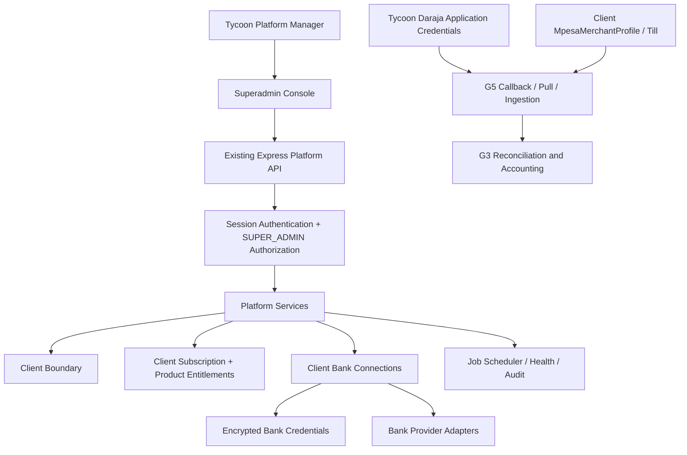

# Tycoon Estates — Superadmin Technical Review Baseline

**Document:** Technical Architecture and Adversarial Review Baseline  
**Status:** Baseline drafted from Manager sign-off and backend inspection  
**Date:** 2026-11-14  
**Repository:** `jolla3/tycoon-estates-backend`  
**Verified source baseline:** GitHub `main` at `d322374abac0cd35ce205e916de70c453af0eeda`  
**Related product requirements:** [`TYCOON_SUPERADMIN_BACKEND_FIRST_BASELINE.md`](./TYCOON_SUPERADMIN_BACKEND_FIRST_BASELINE.md)  
**Agent context and implementation constraints:** [`TYCOON_SUPERADMIN_CURRENT_BACKEND_MAP.md`](./TYCOON_SUPERADMIN_CURRENT_BACKEND_MAP.md)

---

## 1. Architecture objective

Build an internal Platform Manager console on top of the existing Tycoon backend. The console must let the Manager provision clients, explicitly assign Banking and/or M-PESA, manage monthly subscription assignments, inspect each client's provider configuration and readiness, and diagnose platform/worker health.

This is an additive control-plane capability. It must not rewrite the existing customer business domain, create a second accounting system, or collapse platform credentials and customer merchant/bank identities into one record.

## 2. Non-negotiable domain invariants

1. **Client is the tenant boundary.** All customer-owned business and integration records remain scoped to one Client.
2. **Product entitlement is explicit.** A client can have `BANKING`, `MPESA`, both, or neither. Do not infer entitlement from the existence of provider records.
3. **Subscription and payment are different facts.** The Manager assigning an active monthly subscription is not proof of payment. A trial is a trial. Payment is only recorded when a real subscription transaction is available and verified.
4. **Subscription is client-level.** The current model has one Subscription per Client. Do not add per-estate subscriptions or invoice complexity.
5. **Tycoon owns the Daraja application.** Daraja Consumer Key/Secret and environment configuration are platform-level secrets.
6. **The client owns its merchant Till identity.** Each `MpesaMerchantProfile.businessShortCode` belongs to one Client. Never treat the client's Till as Tycoon's own merchant account.
7. **Bank credentials belong to the client connection.** Store and retrieve them only through client-scoped `BankConnection` / `BankCredential` references and the existing encryption boundary.
8. **Integration readiness is evidence-derived.** Entitled, configured, authenticated, provider-verified and operational are distinct states.
9. **No credential disclosure.** UI, API, logs and audit metadata must not expose plaintext secrets, access tokens or encrypted secret envelopes.
10. **Preserve G3/G4/G5 ownership.** G3 remains the rent accounting authority; G4 remains the bank integration foundation; G5 remains the M-PESA ingestion foundation. The Superadmin console orchestrates and observes them; it does not duplicate them.

## 3. System context and topology



The Manager console communicates with the backend API. It must not connect directly to MongoDB, Redis, provider endpoints or secret stores. All authorization, client scoping, secret resolution and state transitions remain server-side.

The existing repository is a Node.js/Express backend using MongoDB/Mongoose, Redis-backed infrastructure/jobs and session authentication. No frontend repository or framework was established during this review. Do not choose React, Next.js, Vue or another frontend stack based only on assumption; inspect the actual frontend project before implementing UI code.

## 4. Technology and existing service boundaries

| Concern | Existing foundation | Architecture direction |
|---|---|---|
| HTTP API | Express routes/controllers | Extend `/api/v1/platform`; keep controllers thin |
| Authentication | Session-based `authenticate` middleware | Preserve session auth; do not introduce a parallel token scheme |
| Authorization | `authorize('SUPER_ADMIN')` | Required for every platform route |
| Tenant scoping | `clientContext` and service-level `clientId` filters | Reuse and strengthen; UI-selected client is never trusted by itself |
| Persistence | MongoDB + Mongoose | Extend the current Client/Subscription model carefully |
| Background work | Existing job scheduler and Redis | Report truthful scoped outcomes; do not create a second scheduler |
| Banking | `BankConnection`, `BankCredential`, `BankAccount`, existing adapters | Preserve client-scoped connection and encryption model |
| M-PESA | `MpesaMerchantProfile`, Daraja OAuth/C2B/Pull/G5 ingestion | Preserve platform-app/client-merchant separation |
| Accounting | Existing G3 reconciliation/accounting posting | Keep as sole rent accounting authority |
| Audit | `AuditLog` and `audit()` service | Strengthen durability/redaction; show failures |

## 5. Domain model and ownership

### 5.1 Client

Current model:

```text
Client
  _id
  name
  isActive
  createdAt
  updatedAt
```

`Client` remains the root customer boundary. Do not add bank or Till secrets directly to Client. Product entitlements belong with the client-level subscription assignment described below, unless a later approved requirement changes the one-subscription-per-client model.

### 5.2 Subscription and product entitlement

Current model:

```text
Subscription
  _id
  clientId       // unique, one per Client
  plan           // trial | basic | pro
  status         // active | past_due | canceled (current enum)
  startDate
  endDate?
  createdAt
  updatedAt
```

Recommended minimal target shape:

```text
Subscription
  clientId                 // unique; one subscription per Client
  plan                     // retain current plan IDs; do not invent price/features
  status                   // access/assignment state, not payment proof
  products[]               // BANKING and/or MPESA; explicit Manager assignment
  startDate                // start of assigned term
  endDate?                 // end of assigned term, where set
  assignedByUserId         // Platform Manager actor
  lastChangedByUserId?     // audit-friendly actor reference
  createdAt
  updatedAt
```

This is a target contract, not a claim that `products`, `assignedByUserId` or Manager subscription mutations exist in current code. Use the existing Subscription record; do not create a separate subscription per product or estate.

**Status semantics:** `status` describes whether the subscription/service assignment is active or canceled. It does not mean money was received. The existing `past_due` enum must not be automatically assigned based on a missing payment record or an elapsed date. It is a legacy state with no Manager-approved operational meaning in this baseline.

**Payment evidence:** there is currently no dedicated SaaS subscription payment model or provider flow. Do not add automatic billing, invoice, payment-attempt or dunning subsystems. When an actual transaction source is agreed, a minimal payment-evidence record can reference `subscriptionId`, `clientId`, source transaction identity, amount/currency, transaction time and verification state. That must be distinct from tenant rent Payment/Ledger records in G3. Until that source and workflow are defined, display payment as “not recorded / no evidence linked”, not “paid” or “unpaid” inferred from subscription status.

**Monthly term handling:** the Manager assigns the monthly subscription term and controls its renewal/changes. Current `startDate`/`endDate` fields are insufficiently enforced: `subscriptionService.isActive()` checks status and does not apply `endDate`. Before enforcing expiry, define and implement the exact behavior for an elapsed monthly term. Do not silently auto-renew or use missing payment evidence as an expiry signal.

### 5.3 Banking model

Preserve the existing relationship:

```text
Client 1 ─── * BankConnection 1 ─── 1 BankCredential
                 │
                 └────────────── * BankAccount
```

- `BankConnection` belongs to exactly one `clientId` and one bank provider.
- Multiple connections for a client/provider are supported by the current model.
- `BankConnection` holds credential reference/version and lifecycle metadata, not plaintext secret values.
- `BankCredential` stores the encrypted AES-256-GCM credential envelope, with key/version and owner/provider binding.
- Bank accounts retain client and estate association and reference the connection that authorizes them.
- Connection authentication state, account validation state, product entitlement and sync capability must remain separate.
- Never add a global customer-specific bank credential fallback.
- Preserve the current provider truth: Co-op adapter exists but is not operationally verified; KCB, Equity and NCBA are not ready adapters.

The Superadmin API may show safe connection/account metadata and derived status. It must never return `credentialsRef` in a way that allows secret retrieval from the browser, secret envelopes, tokens or plaintext credentials.

### 5.4 M-PESA model

The ownership model is:

```text
Tycoon platform configuration
  DARAJA_CONSUMER_KEY
  DARAJA_CONSUMER_SECRET
  DARAJA_ENVIRONMENT
          │
          ▼
  Daraja OAuth client / G5 service
          │
          ├────────────── Client A merchant profile / Till A
          ├────────────── Client B merchant profile / Till B
          └────────────── Client N merchant profile / Till N
```

Current model:

```text
MpesaMerchantProfile
  clientId
  provider: SAFARICOM
  merchantType: BUY_GOODS_TILL
  displayName?
  businessShortCode
  estateId?                 // one optional estate reference
  callbackCapability
  pullCapability
  operationalState
  registration metadata
```

The platform OAuth client uses Tycoon's application credentials. `MpesaMerchantProfile.businessShortCode` identifies the customer merchant. Do not copy platform Consumer Key/Secret into a client profile; do not show them in the UI.

Current code does not store a per-profile credential reference and does not expose a Superadmin merchant credential rotation/assignment API. Do not invent client-specific secrets or passkeys unless a verified endpoint requires them.

**Important live-authorization gate:** a process-level OAuth token proves that the Tycoon Daraja application authenticated. It does not prove that Safaricom authorizes that app/credential set to query, register callbacks for, or ingest transactions from every client-owned Till. Before displaying a client as operational, verify the precise merchant/app permission and environment. Keep the distinction between platform credentials and client merchant identity in all API payloads and UI labels.

The latest provider evidence (`docs/provider-contracts/G5_DARAJA_C2B_PULL_EVIDENCE.md`) records sandbox OAuth and C2B v2 registration evidence, but the `174379` and `600987` shortcode relationship remains unknown. Callback endpoints remain not exposed; Pull registration/query has not been run for this merchant; Pull eligibility, nominated number, Buy Goods Pull fixture, pagination terminal semantics and full 48-hour entitlement remain unverified; G3 posting remains gated. The Superadmin UI must display those blockers rather than a green connected badge.

### 5.5 Tenant financial domain boundary

Tenant rent `Payment`, receipt ingestion, allocation and ledger posting remain in G3/G5 domain services. SaaS subscription payment evidence is a separate commercial record if/when implemented. The console must never use a tenant payment to mark a client subscription paid.

## 6. API architecture

### 6.1 Existing routes

`src/routes/platform.routes.js` protects all platform routes with `authenticate` and `authorize('SUPER_ADMIN')`.

Current endpoints:

| Endpoint | Current behaviour | Target treatment |
|---|---|---|
| `GET /api/v1/platform/overview` | Platform counts | Extend with client product mix and trustworthy integration/worker aggregates |
| `GET /api/v1/platform/health` | Basic Mongo/Redis/provider/job summary | Replace false-green assumptions with component health and verification states |
| `GET /api/v1/platform/clients` | Paginated; active filter only | Add search and product/plan/readiness filters |
| `POST /api/v1/platform/clients` | Creates Client + owner + Subscription; plan optional; no products | Add explicit product assignment; preserve atomic provisioning |
| `GET /api/v1/platform/clients/:clientId` | Client, owner, subscription and portfolio counts | Add safe Banking/M-PESA summaries and readiness blockers |
| `PATCH /api/v1/platform/clients/:clientId` | Rename client | Preserve profile update; add no accidental entitlement mutation here |
| client activate/deactivate | Updates Client active state | Define consistent worker/API suspension semantics and audit reason |
| `GET /api/v1/platform/users` | Filter by role/client/active | Preserve and make role/client scope explicit |
| `GET /api/v1/platform/audit` | Filter by action/client | Add safe filters and redacted metadata contract |
| `GET /api/v1/platform/subscriptions` | Read-only list | Preserve plus manager assignment/update capability |

### 6.2 Recommended API evolution

Keep the existing `/platform` namespace. Add only the contract needed for the agreed workflows:

- Extend client provisioning input with `products: ['BANKING', 'MPESA']` (array; either, both or empty) and monthly subscription fields where required.
- Extend client list filters with `search`, `product`, `plan`, subscription state and derived integration readiness.
- Extend client detail to return `entitlements`, `subscription`, `bankingSummary`, `mpesaSummary` and safe portfolio counts.
- Add a Manager-controlled subscription assignment/update operation scoped to one client. It should update plan, product set and explicit term dates atomically and audit the Manager. Do not create invoices or payment attempts.
- Keep integration mutation under the existing Banking and G5 service contracts. Do not create generic “set integration ready” flags in PlatformService.
- For selected-client diagnostics, use a server-validated explicit `clientId`. Do not silently substitute the Manager identity or widen queries to all clients.

Exact route names and request schemas should be agreed during API implementation. The requirements above are the contract; this document does not claim the endpoints already exist.

### 6.3 Response shape guidance

Client detail should communicate three independent dimensions:

```json
{
  "client": { "id": "...", "name": "...", "isActive": true },
  "products": ["BANKING", "MPESA"],
  "subscription": {
    "plan": "basic",
    "status": "active",
    "startDate": "...",
    "endDate": "...",
    "paymentEvidence": "not_recorded"
  },
  "integrations": {
    "banking": {
      "configured": true,
      "state": "reauth_required",
      "providers": []
    },
    "mpesa": {
      "configured": true,
      "merchantProfiles": [],
      "state": "blocked",
      "blockers": []
    }
  }
}
```

This is illustrative only. Do not hardcode the example values or expose credential references, tokens, phone numbers, bank account numbers or raw provider payloads in the real response.

## 7. Platform and selected-client authorization

### 7.1 Platform-wide calls

- Require session authentication and `SUPER_ADMIN` role.
- Aggregate only the data needed for the platform control plane.
- Redact customer secrets and sensitive provider values.

### 7.2 Selected-client calls

- The UI must send an explicit selected client context for client workspace operations.
- The backend must validate that the target Client exists and that the Manager is authorized for platform administration.
- Every data query must also constrain by the same `clientId` at the service/repository layer.
- Never use client IDs from a request body as the sole ownership proof for a customer actor; preserve the existing `clientContext` trust model for customer routes.
- Do not implement silent impersonation of a `CLIENT_OWNER`.
- Inactive-client diagnostics should be available only through a deliberately designed read-only platform path. Current `clientContext` rejects inactive clients, so do not bypass it globally.

### 7.3 Deactivation consistency

Current `Client.isActive` is enforced in the normal request context, but the audited worker set does not consistently skip inactive clients. The target architecture must define one consistent policy across HTTP requests, scheduled jobs, bank sync, M-PESA Pull and SMS dispatch. A deactivated client must not continue to receive normal customer operations through an unguarded worker. Platform diagnostics may remain read-only. The exact distinction between paused, deactivated and suspended need not become a multi-state framework unless the product requires it.

## 8. Operational status architecture

### 8.1 Separate readiness dimensions

For every product/integration, report the facts independently:

1. **Entitled:** Manager assigned the product.
2. **Configured:** client integration record/profile exists and has required fields.
3. **Authenticated:** credential/auth operation succeeded.
4. **Provider verified:** the provider has authorized or confirmed the exact merchant/account operation.
5. **Operational:** the required callbacks/pull/sync paths work and durable ingestion succeeds.

Do not compress these into one Boolean `connected` value.

### 8.2 Bank status

Use safe fields from `BankConnection`, `BankAccount` and sync metadata. Distinguish connection authentication from bank-account validation/capabilities. A Co-op adapter existing in source is not equivalent to live bank readiness.

### 8.3 M-PESA status

Use client `MpesaMerchantProfile` fields plus platform Daraja config/health and observed callback/Pull evidence. Report callback and Pull independently. Do not mark the profile operational solely because `DARAJA_CONSUMER_KEY` and `DARAJA_CONSUMER_SECRET` are configured or an OAuth token was obtained.

### 8.4 Job status

The scheduler currently can classify a job as successful when its function returns a summary despite handled per-client failures or deliberate skips. The Superadmin API should expose typed outcomes:

- `SUCCESS`
- `PARTIAL_FAILURE`
- `FAILED`
- `SKIPPED`
- `BLOCKED`
- `RUNNING`

Each outcome should include safe scope metadata such as job name, time, client/provider when applicable, counts, and a redacted error reason. Do not put raw credentials or full provider payloads into the dashboard.

### 8.5 Health endpoint requirements

Health must distinguish:

- application process status;
- MongoDB connectivity;
- MongoDB transaction support/readiness where required by financial paths;
- Redis connectivity;
- job scheduler state and last outcome;
- Banking adapter configuration versus live verification;
- Daraja app configuration versus merchant authorization and callback/Pull readiness;
- SMS required configuration versus provider operational status.

Current `systemHealth()` reports `application: healthy` unconditionally and has incomplete provider checks. In particular, the Celcom provider also needs base URL and sender configuration, and the current check does not perform a live provider verification. Do not use the current health response as a production readiness authority.

## 9. Audit and sensitive actions

All privileged platform actions should have a structured audit event containing:

- actual Manager user ID;
- target client ID, if applicable;
- action and resource type/ID;
- timestamp;
- request correlation metadata;
- concise reason/description where the action changes access, subscription or product entitlement;
- redacted before/after values limited to non-secret fields.

Do not store raw credential values, OAuth tokens, full webhook payloads, or sensitive bank/M-PESA data in `AuditLog.metadata`.

Current `audit()` deliberately catches and logs write errors rather than failing the caller. That means a mutation can complete without a durable audit entry. The implementation must choose a reliable write strategy for high-risk Platform Manager actions (for example, a transaction/outbox pattern where compatible, or an explicit failure result). The UI must not silently display “saved and audited” when the audit write failed.

## 10. Frontend architecture boundary

This repository is backend-only for the Superadmin task. No frontend framework, source repository, route structure or component system has been verified. The PRD defines the information architecture and backend contract, but frontend implementation must first inspect the actual frontend repository and preserve its conventions.

Frontend rules once the repository is known:

- Keep a single explicit selected-client context in the shell.
- Use product entitlement and integration readiness as separate fields in state and components.
- Avoid global client selectors that leak into customer routes.
- Do not cache secrets or provider tokens in browser storage.
- Use the existing session/CSRF model; do not introduce JWT/localStorage shortcuts without a separate security decision.
- Treat API response states as typed values, not green/red booleans.

## 11. Implementation sequence

### Phase 0 — Documentation baseline

- Treat the Superadmin backend-first baseline, current backend map and this review baseline as the documentation contract.
- Re-read and challenge the architecture before writing code.
- Inspect the frontend repository before choosing UI stack or route patterns.
- Re-fetch current GitHub `main` and record its SHA at the start of implementation.

### Phase 1 — Domain contract

- Confirm minimal product entitlement field on the one-per-client Subscription.
- Define Manager subscription assignment/update fields and the meaning of monthly start/end dates.
- Define client deactivation semantics across HTTP and workers.
- Add tests for entitlement and isolation before UI integration.

### Phase 2 — Platform API

- Extend provisioning and client detail/list contracts.
- Add Manager-controlled subscription assignment/update.
- Add derived Banking/M-PESA status summaries using existing integration services/models.
- Add negative tests for cross-client access and secret leakage.

### Phase 3 — Operations reliability

- Correct health checks and typed worker outcomes.
- Enforce inactive-client worker policy.
- Strengthen audit durability and metadata redaction.
- Add dedicated platform/Superadmin tests.

### Phase 4 — Console UI

- Build seven-area information architecture in the existing frontend framework.
- Implement platform-wide and selected-client modes.
- Keep all status displays evidence-derived.

### Phase 5 — Verification

- Verify list/detail filters, entitlement updates, monthly subscription changes and audit records.
- Verify client isolation for every platform and selected-client path.
- Verify bank and Till credentials never appear in API/browser/log output.
- Verify all provider states are honest when provider access is absent or unverified.
- Verify deactivation prevents worker-side business actions.
- Verify G3/G4/G5 regressions and run the actual project test commands. Report exact test execution evidence.

## 12. Adversarial design review — what can break

| Risk | Why it breaks | Required guardrail |
|---|---|---|
| Product assignment inferred from integration records | Clients with an entitlement but no setup appear not subscribed; configured records can survive after entitlement removal | Persist explicit products on the client subscription; derive integration state separately |
| Active means paid | Current subscription status is access state, not transaction evidence | Never render paid without linked real transaction evidence |
| Trial shown as paid/normal plan | Trial is a distinct Manager assignment | Render Trial explicitly and keep payment evidence separate |
| One global Daraja credential assumed to authorize every Till | OAuth success does not prove merchant-specific access | Verify Safaricom application-to-merchant authorization before ready state |
| Client Till treated as Tycoon Till | Customer merchant identity is lost; transactions can be attributed to the wrong customer | `businessShortCode` stays on client-scoped merchant profile and is always displayed with client identity |
| One Till-to-many estate mapping assumed | Current schema has one optional estate per profile | Keep estate mapping explicitly unresolved; do not silently broadcast receipts |
| Bank credential shared globally | Cross-client credential leakage and token reuse | Preserve connection-scoped encrypted BankCredential and owner/provider/version binding |
| Green health despite a broken provider/job | Current health/worker summaries under-report failures | Typed component health and job outcomes based on actual evidence |
| Inactive client still processed by worker | API suspension does not currently cover every worker | Apply one deactivation policy across all scheduled/ingestion work |
| Sensitive action has no durable audit | Audit helper suppresses write failure | Require reliable audit persistence and visible failure semantics |
| Platform UI trusts selected client ID | A UI scope selector is not authorization | Server validates role and client scope on every endpoint |
| Frontend stack invented | Wrong framework or duplicate UI architecture | Inspect actual frontend repo before choosing stack |

## 13. Verified source baseline and provenance

The source facts in this document refer to GitHub `main` at `d322374abac0cd35ce205e916de70c453af0eeda` (2026-11-14). The latest change compared with `5a96f124f45b7f556fc467eb65dbf1bc87413f88` updated G5 documentation, Daraja C2B/Pull contracts, normalization, Pull parsing and related tests; the platform route/service files listed below were unchanged in that comparison.

| Source path | Verified blob SHA at baseline | Relevance |
|---|---|---|
| `src/routes/platform.routes.js` | `8385157f569b53b13ff07b7e7c8ff00948b30b7e` | Superadmin route surface and role gate |
| `src/controllers/platform.controller.js` | `43353a5eda8d831b41d3b5924756ac23d4174116` | Platform request/controller contract |
| `src/services/platform.service.js` | `a809ba6bb3a25822918e70f4a907dd6de3886d49` | Provisioning, client, subscription, overview and health services |
| `src/models/Client.js` | `03c8493ab817b998cf529cf790d8d55ce3473c4c` | Current client fields |
| `src/models/Subscription.js` | `3a11435fbf1d08e9e3bf47b26056b78c9b2f0c65` | Current subscription fields and enum |
| `src/services/subscription.service.js` | `c4462b9a4bc0cf26e5d1889e9dc6592f403c7a25` | Current plan/status behaviour |
| `src/middlewares/clientContext.js` | `ec3691d1d1e45fffb92d43233a1657709786d928` | Client selection and active-client context |
| `src/services/audit.service.js` | `91f514e8fdfedd4a2848b1594ddd3685a16ac1e3` | Best-effort audit write behaviour |
| `src/models/BankConnection.js` | `69abcbf98fda85641bd4c79de39f1b664d2413b3` | Client-owned bank connection |
| `src/models/BankCredential.js` | `f26e5f82f576fc2a2b8bbb6a46df840a5e377d2f` | Encrypted bank credentials |
| `src/models/MpesaMerchantProfile.js` | `4b12fcd147a6c01dced130ae1a4fe6eab544b706` | Client-owned Till/shortcode profile |
| `src/services/mpesa/darajaPull.service.js` | `241128bd319b060e7406bc43e61d29a557b15f49` | G5 Pull service |
| `src/jobs/mpesaPull.job.js` | `951346db2d0d8ee5b16acc7bb2a9bb9a896a2166` | G5 Pull worker gating and processing |
| `docs/provider-contracts/G5_DARAJA_C2B_PULL_EVIDENCE.md` | `4844bae384aed99c86e00fda483adc6d1de2adbe` | Current provider evidence and unresolved gates |

The repository tree at this baseline contains root `PRD.md`, `architecture.md` and `architecture-summary.md` for G4 Banking/Co-op. They are intentionally not replaced by this Superadmin documentation set. The existing `docs/g5/` documents remain the G5 authority.

**Verification note:** this was a static source/document inspection. No code was modified, no tests were executed, no Daraja requests were sent and no deployment was performed as part of creating this architecture baseline.